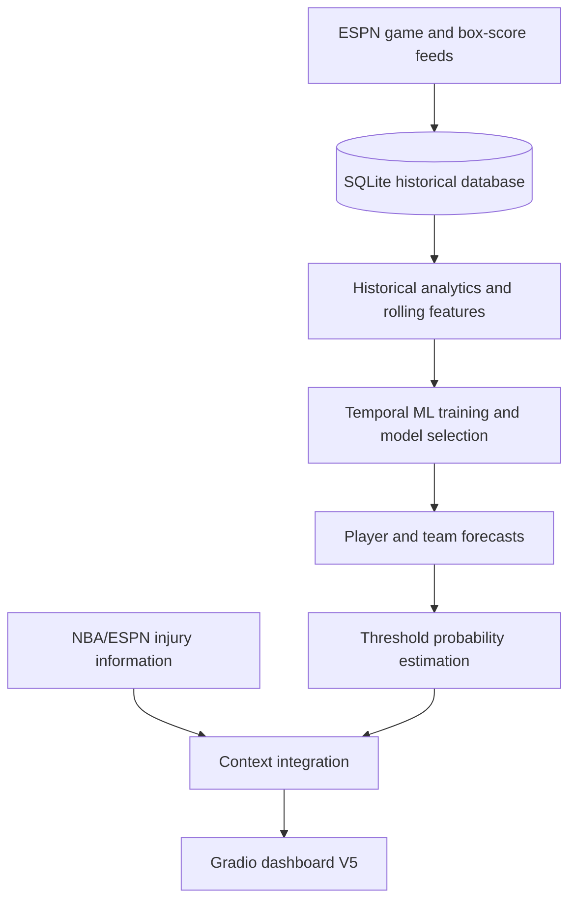

# NBA Intelligence — Real NBA Analytics & Forecast Studio

## Open the REAL NBA analytics demo on Google Colab

[](https://colab.research.google.com/github/zignale-mattia/NBA-Intelligence-ML/blob/main/notebooks/NBA_Intelligence_Public_Demo.ipynb)

**For recruiters:** select the badge, open the Colab notebook, then click **Runtime → Run all**. It downloads **real ESPN player logs for 14 modeled athletes plus up to 180 recent completed NBA games and all participant box scores**, creates two isolated SQLite databases, trains and evaluates Ridge, Random Forest and Extra Trees forecasting models, retrieves actual upcoming ESPN team fixtures and launches a Gradio dashboard with real players, observed statistics and source links.

**No synthetic NBA game data or invented player performances are used in this demo.** No personal Google Drive, credentials, private database or previously trained model files are required. A network connection to ESPN is required, and the temporary Gradio share link lasts only while Colab is running. Model forecasts and threshold estimates are uncertain; fixture listings do not guarantee that a player will participate. See [Colab setup and limitations](docs/COLAB.md).

[Open the separate original 14-stage research notebook](https://colab.research.google.com/github/zignale-mattia/NBA-Intelligence-ML/blob/main/notebooks/NBA_Data_Science_Analytics_V4_sanitized.ipynb). The full notebook has broader features and is **not** validated as a one-click clean-room workflow.

## Portfolio dashboard — 9 professional research sections

**Live ESPN integration test, 27 November 2026:** **180 real completed games, 3,993 player performances, 460 NBA athletes, and all 30 teams**. Zero failed ESPN requests in this test. Counts vary as the rolling NBA season window changes. Only official regular-season fixtures are included; the tables are not full-season standings.

| Dashboard section | What the recruiter can explore |
| --- | --- |
| **Overview** | NBA coverage KPIs, interactive scoring charts, team win percentages, real results and recent player box scores |
| **Forecast Studio** | Real-data ML estimates for PTS, REB, AST, 3PM, PRA; source-linked fixtures, actual player trends, last-10/20 form and thresholds |
| **Player Intelligence** | Search hundreds of players, 5/10/20/50-game histories, trends, distributions, shooting breakdown and ESPN citations |
| **Compare Players** | Head-to-head time series, averages, median, game highs, volatility and configurable windows |
| **League Leaders** | Ranking by points, rebounds, assists, made threes, PRA, minutes, steals or blocks with minimum-games filters |
| **Game Center** | Real final scores, all player box-score lines, team and athlete filters, shooting, turnovers, steals and blocks |
| **Team Analytics** | All 30 clubs, sample W/L, points for/against, recent results and roster scoring leaders |
| **Data Explorer** | Search thousands of deduplicated ESPN observations by athlete, opponent and team |
| **ML Model Audit** | Chronological training/validation/test splits, real holdout MAE, rolling baseline comparison and methodology notes |

**The distinction matters:** all listed game observations are real NBA statistics. The predictive models cover **14 featured athletes with longer histories**, not every player in the 460-athlete explorer. Estimates are not guarantees, threshold frequencies are not formally calibrated probabilities, and scheduled team games do not guarantee an athlete will play.

The Gradio dashboard has a custom dark research-terminal design, responsive KPI cards, and interactive Plotly charts. The public Colab notebook creates disposable ESPN-derived databases at launch. It neither includes nor connects to the author's personal Drive.

**Research portfolio project** · Python · Machine Learning · ESPN-derived basketball data · Google Colab · Gradio

This repository presents an interactive real-data NBA analytics portfolio alongside the original research-stage NBA system. It collects game and player box scores, engineers pregame features, trains forecasting models and estimates probability thresholds. The original project was developed interactively in Google Colab. **The public dashboard has passed a local live-ESPN and Gradio browser smoke test. The full original research workflow is not claimed to be a verified production service.**

## What the project does

- **Data engineering:** ingest ESPN game schedules and player box scores into SQLite, with an incremental update stage.
- **Exploratory analytics:** summarize player and team performance.
- **Win predictions:** train and evaluate a team win classifier with chronological partitions.
- **Player forecasting:** predict PTS, REB, AST, made three-pointers (3PM) and PRA using rolling history and contextual features.
- **Model selection:** compare Ridge, Random Forest, ExtraTrees, XGBoost and LightGBM candidates, retaining training-time temporal evaluation.
- **Probability estimates:** produce empirical threshold probabilities from historical prediction errors.
- **Availability context:** incorporate injury-status information, with limitations on freshness and certainty.
- **Dashboard:** V5 Gradio visualization source is included. Later dashboard experiments are **not** included as a deployable V6 application.

## Architecture



See [Architecture](docs/ARCHITECTURE.md) for the stage-to-file map and important dependencies.

## Repository structure

| Path | Purpose |
| --- | --- |
| `notebooks/NBA_Intelligence_Public_Demo.ipynb` | Real ESPN public Colab analytics & forecasting demo, clickable badge above |
| `demo/` | Real ESPN ingestion, independent SQLite, chronological ML models, Gradio UI and notebook generator |
| `notebooks/NBA_Data_Science_Analytics_V4_sanitized.ipynb` | Curated 14-cell research workflow; execution outputs removed |
| `src/` | Extracted Colab-oriented stage references and a small, testable configuration helper |
| `dashboard/STEP_24_Dashboard_V5.py` | Original V5 Gradio dashboard source |
| `tests/` | Fast structural and configuration tests requiring no private NBA dataset |
| `.github/workflows/validate.yml` | Automated syntax, notebook and config checks on each push |
| `docs/` | Architecture, validation scope and release checklist |

**Important:** Files extracted under `src/` (apart from `project_config.py`) are **reference-stage scripts**, not independent CLI commands. Many assume Colab state, Drive data or artifacts produced by earlier stages.

## Run the full research workflow in Google Colab

1. Open `notebooks/NBA_Data_Science_Analytics_V4_sanitized.ipynb` in Google Colab.
2. Install the dependencies in `requirements.txt` in the Colab runtime. For example, after cloning this repository:

   ```python
   %pip install -r /content/NBA-Intelligence-ML/requirements.txt
   ```

3. Run **cell 1: Environment setup** before the remaining stages. It checks the `NBA_DATA_DIR` environment variable, looks for an existing NBA database in known Colab Drive mounts and otherwise mounts the standard Google Drive location.
4. Use **your own** NBA data directory (default: `/content/drive/MyDrive/NBA_Data_Science`). You can override it with `NBA_DATA_DIR`; if overriding to a Drive directory, mount Drive first.
5. Execute only the stages needed for your goal, in the documented order. Forecast and dashboard stages require data files and trained models generated by earlier stages. The public GitHub repository does **not** contain those artifacts.

The notebook still uses external network APIs and was originally developed with specific data and model state. There is **no claim of a successful clean-room end-to-end execution**.

## Dashboard access

The included dashboard is the **V5 source**, intended for the original Colab environment and corresponding generated forecast files. Before launch, provide a password in the private runtime through `NBA_DASHBOARD_PASSWORD`, or enter a password at the hidden interactive prompt. No password should be committed or printed.

The dashboard source currently requests a temporary Gradio public share link (`share=True`); the link may be reachable on the internet **even though the app requires login**. Do not run it with personal or licensed data you do not wish to expose, and do not treat it as a production security boundary.

## Validation

Automated offline checks can be run with no database or network access:

```bash
python -m unittest discover -s tests -v
```

These tests check Python source syntax, notebook syntax and output sanitation, the configurable data path and absence of tracked database/model binaries. **They do not measure predictive accuracy, run the ESPN pipeline or validate dashboard rendering.** See [Testing & limitations](docs/TESTING.md).

## Data, privacy and limitations

- No raw box scores, SQLite databases, exported CSV/Excel reports, pre-trained model binaries, private credentials or Colab execution outputs are distributed. The demo fetches real athlete histories, league scoreboards and per-game player box scores from ESPN at runtime and creates two temporary SQLite databases.
- Before redistribution, review ESPN/NBA data-source terms and image rights.
- Injury reports may be incomplete or stale. Probabilities are conditional model estimates, not guarantees.
- Historical prediction performance must be evaluated using actual *pregame* forecasts and correctly separated chronological data. There are no independently verified accuracy metrics in this public release.
- Package requirements are listed but not version-locked; a tested reproducible environment is still a future improvement.
- This repository deliberately omits experimental backtesting scripts from the current tree. Earlier Git commits may still contain development versions.

## License

No license has been selected. The code is viewable as a portfolio; public visibility **does not automatically grant permission to reuse it**.
