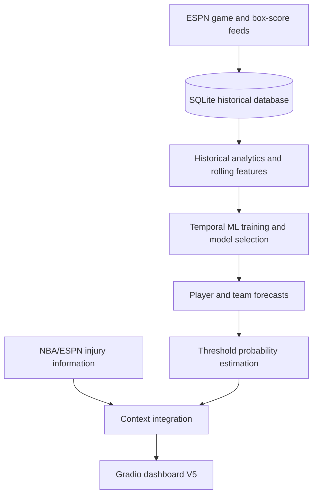

# NBA Intelligence — NBA Player Forecasting & Analytics


## Try the public interactive Colab demo

[](https://colab.research.google.com/github/zignale-mattia/NBA-Intelligence-ML/blob/main/notebooks/NBA_Intelligence_Public_Demo.ipynb)

**One-click Colab notebook for recruiters:** click the badge, then **Runtime → Run all** to create a reproducible synthetic basketball database, train a transparent ridge-regression forecasting model, inspect chronological holdout results and launch a Gradio interface. No Google Drive, private credentials or original database are required. The generated temporary Gradio share link works while the Colab session remains active.

**Critical distinction:** the quick demo contains **fabricated players and simulated game statistics only**. It does **not** produce real NBA forecasts or validate the original research models. For detailed prerequisites and privacy details, read [the Colab guide](docs/COLAB.md).

[Open the full 14-stage research notebook in Colab](https://colab.research.google.com/github/zignale-mattia/NBA-Intelligence-ML/blob/main/notebooks/NBA_Data_Science_Analytics_V4_sanitized.ipynb) — advanced, requires real-data collection and stage-by-stage execution, not one-click.


**Research portfolio project** · Python · Machine Learning · ESPN-derived basketball data · Google Colab · Gradio

This repository presents a source-code demonstration of an NBA data-science system. It collects game and player box scores, engineers pregame features, trains forecasting models and estimates probability thresholds. The original project was developed interactively in Google Colab. **This repository is not advertised as a reproducible one-click service or a validated production system.**

## What the project does

- **Data engineering:** ingest ESPN game schedules and player box scores into SQLite, with an incremental update stage.
- **Exploratory analytics:** summarize player and team performance.
- **Win predictions:** train and evaluate a team win classifier with chronological partitions.
- **Player forecasting:** predict PTS, REB, AST, made three-pointers (3PM) and PRA using rolling history and contextual features.
- **Model selection:** compare Ridge, Random Forest, ExtraTrees, XGBoost and LightGBM candidates, retaining training-time temporal evaluation.
- **Probability estimates:** produce empirical threshold probabilities from historical prediction errors.
- **Availability context:** incorporate injury-status information, with limitations on freshness and certainty.
- **Dashboard:** V5 Gradio visualization source is included. Later dashboard experiments are **not** included as a deployable V6 application.

## Architecture



See [Architecture](docs/ARCHITECTURE.md) for the stage-to-file map and important dependencies.

## Repository structure

| Path | Purpose |
| --- | --- |
| `notebooks/NBA_Intelligence_Public_Demo.ipynb` | Standalone public Colab demo (synthetic-only), clickable badge above |
| `demo/` | Synthetic game generation, independent SQLite, ridge training, Gradio UI and notebook generator |
| `notebooks/NBA_Data_Science_Analytics_V4_sanitized.ipynb` | Curated 14-cell research workflow; execution outputs removed |
| `src/` | Extracted Colab-oriented stage references and a small, testable configuration helper |
| `dashboard/STEP_24_Dashboard_V5.py` | Original V5 Gradio dashboard source |
| `tests/` | Fast structural and configuration tests requiring no private NBA dataset |
| `.github/workflows/validate.yml` | Automated syntax, notebook and config checks on each push |
| `docs/` | Architecture, validation scope and release checklist |

**Important:** Files extracted under `src/` (apart from `project_config.py`) are **reference-stage scripts**, not independent CLI commands. Many assume Colab state, Drive data or artifacts produced by earlier stages.

## Run the full research workflow in Google Colab

1. Open `notebooks/NBA_Data_Science_Analytics_V4_sanitized.ipynb` in Google Colab.
2. Install the dependencies in `requirements.txt` in the Colab runtime. For example, after cloning this repository:

   ```python
   %pip install -r /content/NBA-Intelligence-ML/requirements.txt
   ```

3. Run **cell 1: Environment setup** before the remaining stages. It checks the `NBA_DATA_DIR` environment variable, looks for an existing NBA database in known Colab Drive mounts and otherwise mounts the standard Google Drive location.
4. Use **your own** NBA data directory (default: `/content/drive/MyDrive/NBA_Data_Science`). You can override it with `NBA_DATA_DIR`; if overriding to a Drive directory, mount Drive first.
5. Execute only the stages needed for your goal, in the documented order. Forecast and dashboard stages require data files and trained models generated by earlier stages. The public GitHub repository does **not** contain those artifacts.

The notebook still uses external network APIs and was originally developed with specific data and model state. There is **no claim of a successful clean-room end-to-end execution**.

## Dashboard access

The included dashboard is the **V5 source**, intended for the original Colab environment and corresponding generated forecast files. Before launch, provide a password in the private runtime through `NBA_DASHBOARD_PASSWORD`, or enter a password at the hidden interactive prompt. No password should be committed or printed.

The dashboard source currently requests a temporary Gradio public share link (`share=True`); the link may be reachable on the internet **even though the app requires login**. Do not run it with personal or licensed data you do not wish to expose, and do not treat it as a production security boundary.

## Validation

Automated offline checks can be run with no database or network access:

```bash
python -m unittest discover -s tests -v
```

These tests check Python source syntax, notebook syntax and output sanitation, the configurable data path and absence of tracked database/model binaries. **They do not measure predictive accuracy, run the ESPN pipeline or validate dashboard rendering.** See [Testing & limitations](docs/TESTING.md).

## Data, privacy and limitations

- No raw real-data box scores, SQLite databases, exported CSV/Excel reports, pre-trained model binaries, private credentials or Colab execution outputs are distributed. The public demo generates its own temporary synthetic-only SQLite data.
- Before redistribution, review ESPN/NBA data-source terms and image rights.
- Injury reports may be incomplete or stale. Probabilities are conditional model estimates, not guarantees.
- Historical prediction performance must be evaluated using actual *pregame* forecasts and correctly separated chronological data. There are no independently verified accuracy metrics in this public release.
- Package requirements are listed but not version-locked; a tested reproducible environment is still a future improvement.
- This repository deliberately omits experimental backtesting scripts from the current tree. Earlier Git commits may still contain development versions.

## License

No license has been selected. The code is viewable as a portfolio; public visibility **does not automatically grant permission to reuse it**.
